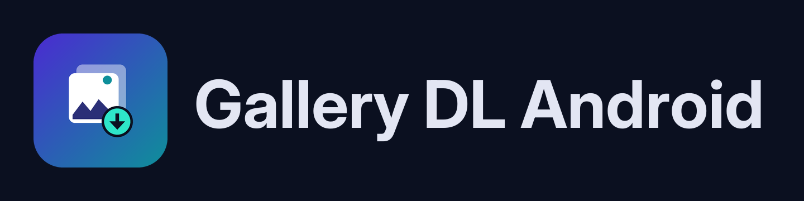
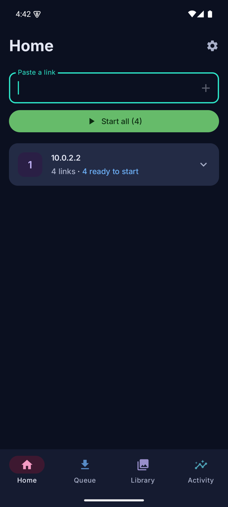
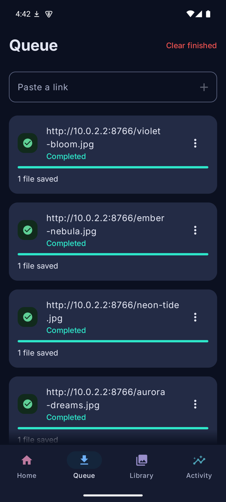
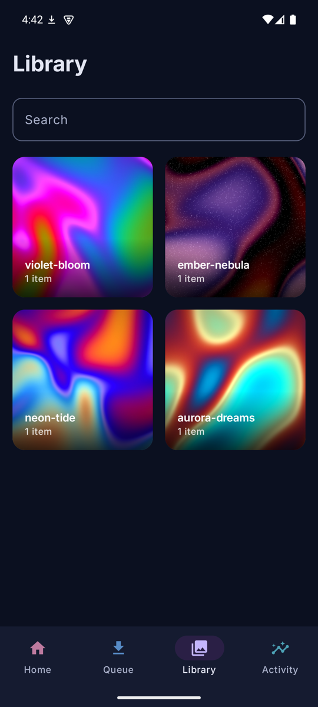
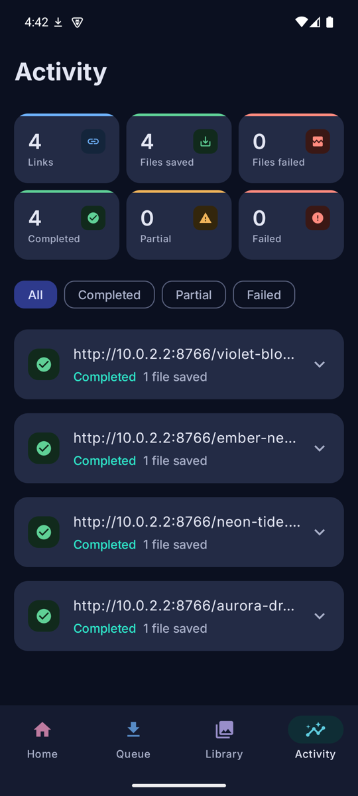
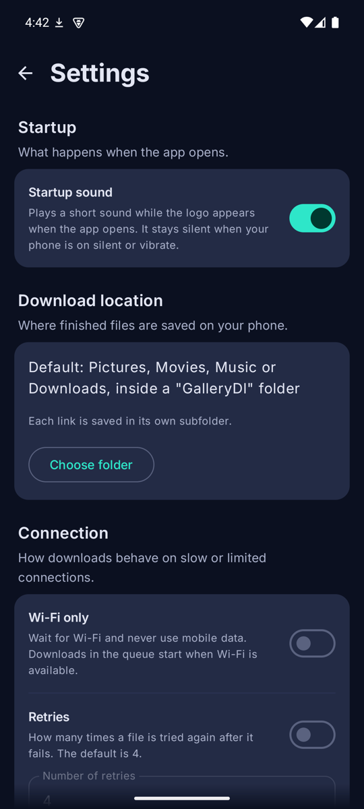

<div align="center">



**A native Android front end and download manager for [gallery-dl](https://github.com/mikf/gallery-dl).**

gallery-dl runs *inside the app* (embedded Python via [Chaquopy](https://chaquo.com/chaquopy/)),
so there is no server and no backend.


</div>

<br>

<div align="center">
<table>
  <tr>
    <td></td>
    <td></td>
    <td></td>
    <td></td>
    <td></td>
  </tr>
  <tr align="center">
    <td><b>Home</b></td>
    <td><b>Queue</b></td>
    <td><b>Library</b></td>
    <td><b>Activity</b></td>
    <td><b>Settings</b></td>
  </tr>
</table>
</div>

## Features

- **One link at a time.** Paste a link; it is validated against gallery-dl's supported sites and queued.
- **Live progress.** Overall percent when the site reports an album size, otherwise per-file percent.
- **A folder per link.** Saved to shared storage (Pictures / Movies / Music / Downloads under `GalleryDl/`, no
  storage permission needed) or to a folder you pick.
- **Library.** One folder per link, swipeable full-screen viewer, multi-select delete, search. Entries disappear
  when their files are deleted outside the app.
- **Activity.** Per-link results (completed / partial / failed), file counts, error details, and retry. A retry
  only fetches files that are still missing.
- **Download controls.** Wi-Fi-only mode and a configurable retry count.
- **Dark theme only.**

## Tech stack

| Area | Choice |
| --- | --- |
| UI | Kotlin, Jetpack Compose, Material 3 |
| State | ViewModel + coroutines / Flow |
| Storage | Room, DataStore |
| Background work | WorkManager (foreground service) |
| Images | Coil 3 |
| Downloader | Chaquopy (Python 3.12) running gallery-dl 1.28.5 |
| DI | Manual (`AppContainer`) |

```
app/src/main/
  python/gdl_bridge.py     gallery-dl wrapper: progress, failure counts, per-link archive
  java/app/gallerydl/
    data/                  Room entities, DAOs, migrations, repositories, settings
    download/              Python bridge, WorkManager worker, MediaStore/SAF saving
    ui/                    queue, library, activity screens and ViewModels
```

Room schemas are exported to `app/schemas/` and are committed; keep them when changing the database.

## Getting started

### Requirements

- JDK **17** (the Android Gradle Plugin used here does not support newer JDKs)
- Android SDK with platform 35 and build-tools 35 (`ANDROID_HOME` set, or `sdk.dir` in `local.properties`)
- Python 3 on the build machine (Chaquopy uses it to install gallery-dl)
- Android 10 (API 29) or newer to run; arm64 and x86_64 are bundled

### Build

```sh
export ANDROID_HOME=/path/to/android-sdk
export JAVA_HOME=$(/usr/libexec/java_home -v 17)   # macOS

./gradlew :app:assembleDebug          # app/build/outputs/apk/debug/app-debug.apk
./gradlew :app:installDebug           # build and install on a connected device/emulator
```

### Signed release build

1. Create a keystore and copy `keystore.properties.example` to `keystore.properties` (git-ignored).
2. `./gradlew :app:assembleRelease` -> `app/build/outputs/apk/release/app-release.apk`

> [!IMPORTANT]
> Back up the keystore: updates to an installed app must be signed with the same key.
> Without `keystore.properties` the release build is produced unsigned.

Debug and release builds use different signing keys, so switching an installed copy requires
`adb uninstall app.gallerydl` first (this clears app data).

### Release builds use R8

`app/proguard-rules.pro` keeps `com.chaquo.python.**` and the `DownloadListener` implementations. Chaquopy's native
code finds its Java classes by name, so without these rules `Python.start()` crashes with a native `SIGSEGV` in
release builds only. After changing shrinker settings or upgrading Chaquopy/AGP, install the **release** APK and run a
real download before shipping.

## Known limitations

- No login or cookie support, so private or login-gated content will not download.
- No overall percentage for links that expand into many other links (profiles, threads); those show per-file progress.
- No pinch-to-zoom in the viewer.

## Credits

- [gallery-dl](https://github.com/mikf/gallery-dl) by Mike Fährmann does the actual downloading.
- [Inter](https://rsms.me/inter/) font, licensed under the SIL OFL (see [docs/licenses](docs/licenses/Inter-OFL.txt)).
- Screenshot images are abstract art generated with a small script, so there is nothing to attribute.
